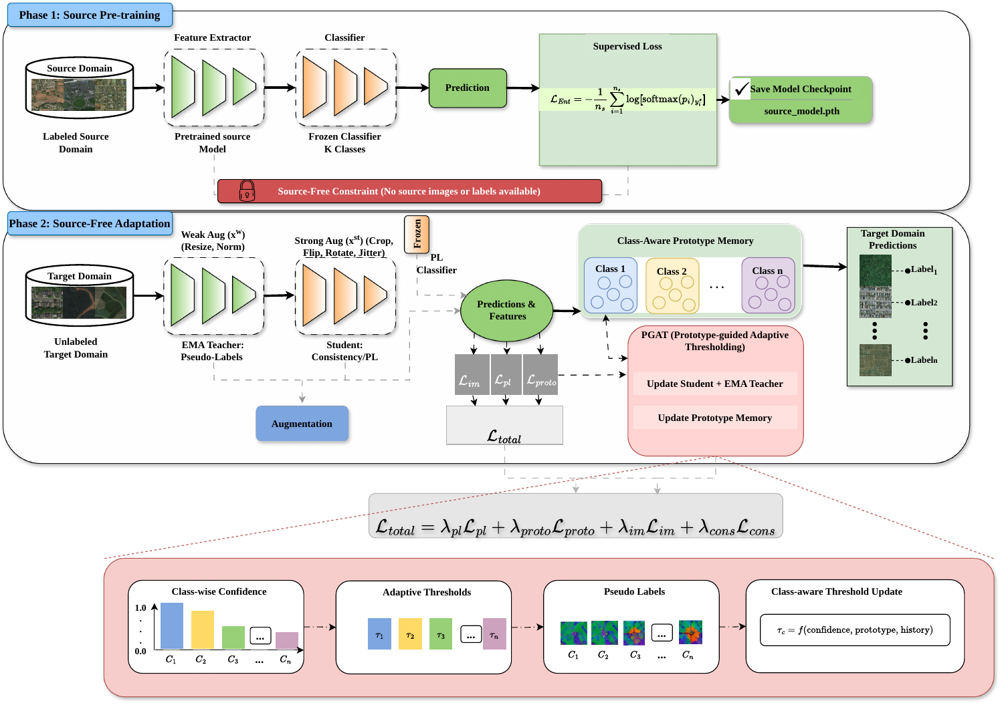

# CAB-SFDA: Class-Aware Balanced Source-Free Domain Adaptation for Remote Sensing Scene Classification

Official PyTorch implementation of **CAB-SFDA** with the **Prototype-Guided Class-Adaptive Threshold
(PGAT)**, together with the eight source-free domain adaptation (SFDA) baselines and the complete
experimental pipeline of the paper:

> M. Khazri Khelifi, A. Ammar, W. Boulila, I. R. Farah. *CAB-SFDA: Class-Aware Balanced Source-Free
> Domain Adaptation for Remote Sensing Scene Classification.* Applied Soft Computing (under review).

One command reproduces every table and figure of the paper. Every reported number is computed by
`aggregate.py` from per-run result files and can be traced back to the runs it comes from
(`tables/provenance.csv`).



## Method in brief

CAB-SFDA adapts a model trained on a labeled source domain to an unlabeled target domain **without
access to the source data**.

* **Frozen classifier.** The source classifier is kept fixed; only the feature extractor (ResNet
  backbone and 128-d projection head) is adapted.
* **EMA (mean) teacher.** A teacher that follows the student through an exponential moving average
  (momentum 0.999 per iteration) labels the weakly augmented view. It provides the pseudo-labels,
  the inputs of PGAT, the features of the prototype memory, and the consistency target.
* **Class-aware momentum prototype memory.** One prototype per class, updated from the teacher
  features of the accepted pseudo-labels (EMA, momentum 0.9). Its accepted-sample counts define
  inverse-square-root class weights for the pseudo-label loss.
* **PGAT.** One adaptive confidence threshold per class, driven by two reliability signals
  (classifier confidence and cosine agreement with the class prototype), with a warm-up and a
  strict one-step causal lag: the threshold that accepts a batch is computed from previous batches
  only.
* **Objective.** `L = 1.0 L_im + 0.3 L_pl + 0.3 L_cons + 0.1 L_proto`: information maximization on
  the student's weak view, class-balanced cross-entropy on the strong view for the PGAT-accepted
  samples, one-way KL divergence from the teacher (weak view) to the student (strong view), and
  cosine attraction of the student's weak-view features to their class prototypes.

The code is in `cabsfda/cab_sfda.py` (training loop), `cabsfda/memory.py` (prototype memory and class
weights), `cabsfda/thresholds.py` (PGAT and the threshold baselines), `cabsfda/losses.py` and
`cabsfda/optim.py` (shared optimizer and EMA update).

## Results

Overall accuracy (%) averaged over the 12 cross-scene tasks (AID, CLRS, MLRSN, RSSCN7) and the four
cross-sensor tasks (NWPU-RESISC45 ↔ NaSC-TG2, WHU-RS19 ↔ EuroSAT), mean ± std over three seeds. All
methods start from the same source model for each task and seed and share the same optimization
protocol. Reliability: median over the 16 tasks of the seed-to-seed standard deviation, and number
of the 48 runs that end below their own source model.

| Method | Cross-scene | Cross-sensor | Median std (pp) | Runs below source |
|---|---|---|---|---|
| Source model | 66.82 ± 0.51 | 39.13 ± 2.21 | – | – |
| SHOT | 70.74 ± 2.88 | 43.36 ± 5.80 | 6.03 | 17 |
| NRC | 68.45 ± 4.06 | 43.81 ± 3.41 | 8.47 | 16 |
| CoWA | 64.77 ± 2.17 | 42.05 ± 1.42 | 4.82 | 19 |
| MBNS | 68.13 ± 4.37 | 44.70 ± 2.13 | 7.03 | 11 |
| G-SFDA | 64.53 ± 5.17 | 35.53 ± 3.37 | 5.88 | 25 |
| AaD | 70.50 ± 0.85 | 47.49 ± 7.35 | 4.26 | 13 |
| DaC | **76.31 ± 1.91** | **51.36 ± 2.95** | 3.70 | **1** |
| SMNA | 67.52 ± 1.53 | 47.22 ± 9.92 | 5.21 | 17 |
| **CAB-SFDA** | 74.24 ± 0.55 | 49.06 ± 5.01 | **1.64** | 2 |

CAB-SFDA ranks second on both averages, behind DaC, is the best method on M2A, M2C, and N2G, and
has the lowest seed-to-seed variability of all methods, at 57% of the training time per epoch of
DaC. Per-task results, ablations, statistical tests, and the discussion of the failure cases are in
the paper; `aggregate.py` regenerates all of them.

`paper_results/run_inventory.csv` lists the 3,182 runs behind the paper (experiment group, method,
variant, backbone, task, seed) with the test accuracy of the source model and of the adapted model
in each run, taken from the run logs. Every number in the tables of the paper is a mean over rows of
this file. The configuration of a run is `configs/defaults.yaml` + `configs/selected.yaml` + the
overrides of its variant in `cabsfda/experiments.py` (`python launch.py --groups <group> --dry-run`
lists them).

## Repository structure

```
cabsfda/                 library
  cab_sfda.py            CAB-SFDA adaptation (teacher, memory, PGAT, losses, diagnostics)
  memory.py thresholds.py losses.py optim.py models.py data.py metrics.py
  source.py              source-model training (shared by all methods)
  baselines/             SHOT, NRC, CoWA, MBNS, G-SFDA, AaD, DaC, SMNA
  experiments.py         experiment groups, ablation variants, sensitivity grids, pilot grid
  runner.py results.py config.py utils.py
configs/
  defaults.yaml          all hyperparameters (paper Table 5)
  selected.yaml          configuration chosen by the label-free pilot (teacher momentum 0.999)
  datasets.yaml          dataset folders, class mapping, benchmarks, tasks, split settings
splits/                  released train/test splits of the paper (SHA-1 per image), see "Data splits"
paper_results/           run_inventory.csv: per-run accuracies of the 3,182 runs of the paper
prepare_data.py          raw datasets -> data/splits/ (de-duplication + stratified 70/30 split)
import_splits.py         pre-split folders -> audit + disjoint data/splits/
export_splits.py         data/splits/ -> portable splits/ for release
launch.py                runs experiment groups on several GPUs (resumable)
run.py                   a single run
select_hparams.py        label-free hyperparameter selection (SND) from the pilot runs
check_results.py         consistency audit and coverage check of all result files
aggregate.py             all tables (LaTeX, CSV, Markdown) and statistical tests -> tables/
make_figures.py          confusion matrices, t-SNE, sensitivity curves, radar, PGAT dynamics -> figures/
run_all.sh               the complete pipeline, in order
setup_env.sh             conda environment with pinned versions
smoke_test.sh            end-to-end test on a tiny synthetic dataset
smoke_presplit.sh        same, for the pre-split-folder workflow
tests/test_core.py       unit tests
```

## Installation

```bash
git clone https://github.com/ManelKhazriKhlifi/CAB-SFDA-PGAT.git
cd CAB-SFDA-PGAT
bash setup_env.sh              # conda env "cabsfda": Python 3.11, PyTorch 2.7.1, pinned packages
conda activate cabsfda
```

`setup_env.sh` picks the PyTorch CUDA build from the installed driver (force one with
`TORCH_CUDA=cu118|cu126|cu128`), installs `requirements.txt`, checks that CUDA works, and caches the
ImageNet weights. Manual installation:

```bash
conda create -n cabsfda python=3.11 pip -y && conda activate cabsfda
pip install torch==2.7.1 torchvision==0.22.1     # see pytorch.org for other CUDA builds
pip install -r requirements.txt
```

or `conda env create -f environment.yml`. Check the installation (a few minutes on CPU):

```bash
python tests/test_core.py
QUICK=1 bash smoke_test.sh     # must end with "SMOKE TEST PASSED"; writes only under smoke/
```

## Datasets

The datasets are not redistributed. Download them from their authors and place them under one
folder, `$DATA_ROOT`, with one sub-folder per class:

| Domain | Folder under `$DATA_ROOT` | Reference |
|---|---|---|
| AID | `AID/` | Xia et al., IEEE TGRS 2017 – https://captain-whu.github.io/AID/ |
| CLRS | `CLRS/` | Li et al., Sensors 20(4):1226, 2020 – https://www.mdpi.com/1424-8220/20/4/1226 |
| MLRSNet | `MLRSNet/Images/` | Qi et al., ISPRS J. 2020 – https://github.com/cugbrs/MLRSNet |
| RSSCN7 | `RSSCN7/` | Zou et al., IEEE GRSL 2015 – https://github.com/palewithout/RSSCN7 |
| NWPU-RESISC45 | `NWPU-RESISC45/` | Cheng et al., Proc. IEEE 2017 |
| NaSC-TG2 | `NaSC-TG2/` (RGB release, 128 × 128) | Zhou et al., IEEE JSTARS 2021 – https://captain-whu.github.io/BED4RS/ |
| WHU-RS19 | `WHU-RS19/` | Xia et al., ISPRS TC VII 2010 – https://captain-whu.github.io/BED4RS/ |
| EuroSAT | `EuroSAT_RGB/` (RGB release, 64 × 64) | Helber et al., IEEE JSTARS 2019 – https://github.com/phelber/EuroSAT |

`configs/datasets.yaml` maps the shared classes of each benchmark to the dataset folders (matching
ignores case, spaces, `_`, and `-`), and a class can gather several folders with `A+B`: in the
paper, the AID `residential` class gathers `DenseResidential+MediumResidential` (700 images). Edit
the `root:` entries if your layout differs.

| Benchmark | Domains | Shared classes |
|---|---|---|
| Cross-scene (12 tasks) | AID, CLRS, MLRSN, RSSCN7 | farmland, forest, industrial, meadow, parking, residential, river |
| Cross-sensor I (N2G, G2N) | NWPU-RESISC45, NaSC-TG2 | beach, circular farmland, cloud, desert, forest, mountain, rectangular farmland, residential (NWPU: dense residential), river, snowberg |
| Cross-sensor II (E2W, W2E) | WHU-RS19, EuroSAT | farmland (AnnualCrop), forest, industrial, meadow (Pasture), residential, river |

## Data splits

Each domain has one fixed split, used whether the domain is the source or the target: images are
identified by the SHA-1 of their bytes, identical files are kept once, images filed under two classes
are dropped, and the unique images of each class are split 70/30 with a fixed seed (2024). The
source model is trained on the 70% part of the source domain; adaptation uses the 70% part of the
target domain without labels; all accuracies are measured on the held-out 30% target test part.
Within every task, no test image, nor any identical copy of it, is used for training or adaptation.

No SHA-1 of a target test image occurs in the source training split of any of the 16 tasks.
Identical files do occur across benchmark families that are never paired in a task (467 files in
both MLRSN and NWPU-RESISC45, 141 in both AID and WHU-RS19). SHA-1 detects identical files only.

**Splits of the paper.** `splits/<domain>/{train,test}.csv` list the images of every split by SHA-1,
class, and file name. To rebuild exactly these splits from your copy of the datasets:

```bash
export DATA_ROOT=/path/to/datasets
python prepare_data.py --reference splits --resize-cache 128
```

Images are matched by SHA-1 and, if your files were re-encoded, by class and file name; the number
of matched images is printed for every domain and should equal the counts in `splits/summary.csv`
(which are those of Tables 3, 4, and 18 of the paper). Some of our copies were renamed (e.g. RSSCN7
and CLRS), so a copy of a dataset that is both renamed and re-encoded cannot be matched; in that
case, build new splits with the same procedure (below).

**New splits** with the same procedure: `python prepare_data.py --resize-cache 128` (without
`--reference`). **Pre-split folders** (`<dir>/{source,target}_<name>_split/{train,test}/<class>/`):
`python import_splits.py --src <dir> --resize-cache 128` audits the folders (train/test overlap,
duplicates, differences between the source and target copies; `data/splits/audit.txt`) and builds
the same kind of disjoint split from the unique images. `--resize-cache 128` stores 128 × 128 PNG
copies in `data/cache/`, which makes loading much faster.

## Reproducing the paper

```bash
export DATA_ROOT=/path/to/datasets
GPUS=0,1,2,3 JOBS_PER_GPU=2 WORKERS=6 bash run_all.sh 2>&1 | tee run_all.log
```

`run_all.sh` builds the splits (from `splits/` when present), uses the configuration of
`configs/selected.yaml`, runs every experiment group, audits the results, and writes `tables/` and
`figures/`. It can be re-run after an interruption: finished runs are skipped. Step by step:

```bash
python launch.py --groups main,baselines --gpus 0,1,2,3 --jobs-per-gpu 2
python check_results.py --groups main baselines          # audit; warns about collapsed runs
python launch.py --groups ablation_losses,ablation_mechanisms,backbone --gpus 0,1,2,3 --jobs-per-gpu 2
python launch.py --groups imbalance,sensitivity --gpus 0,1,2,3 --jobs-per-gpu 2
python launch.py --groups timing --gpus 0,1,2,3 --jobs-per-gpu 1 --seeds 0
python aggregate.py && python make_figures.py
```

`--dry-run` lists the runs, `--seeds` and `--tasks` restrict them, and `--set key=value` overrides
the configuration of every job (`CABSFDA_SET="key=value ..."` does the same for every script).
Job logs are in `results/logs/` and failures in `results/launch_status.json`.

### Experiment groups

| Group | Runs (16 tasks × 3 seeds unless stated) | Paper |
|---|---|---|
| `main` | CAB-SFDA (48) | Tables 6–9, 14–15; Figures 3–5, 11–15 |
| `baselines` | SHOT, NRC, CoWA, MBNS, G-SFDA, AaD, DaC, SMNA (384) | Tables 6, 8, 9, 17; Figure 6 |
| `ablation_losses` | without L_pl, L_im, L_proto, or L_cons (192) | Table 12 |
| `ablation_mechanisms` | design variants A–F (see below) | Table 13 |
| `backbone` | ResNet-18, ResNet-101 (96) | Table 11 |
| `imbalance` | 9 methods × 5 imbalance ratios × {A2M, C2M, R2M} (405) | Table 16 |
| `sensitivity` | λ_pl, λ_cons, λ_proto, γ, η_t, teacher momentum, T | Figures 7–10 |
| `timing` | every method on W2E, seed 0, one job per GPU (9) | Table 10 |
| `pilot` | 8 configurations × {A2C, M2R, G2N, E2W}, seed 0 (32) | label-free selection (Section 5.1) |
| `baselines_bn_train`, `threshold_range` | optional (`EXTRA=1`) | not in the paper |

Mechanism ablation variants (`cabsfda/experiments.py`): **A** class balancing (unweighted,
inverse-frequency); **B** prototype memory (none, static, batch, EMA updated with all predictions);
**C** thresholds (fixed 0.90 / 0.85 / 0.80, class-agnostic PGAT, confidence-only PGAT, FlexMatch,
FreeMatch, PGAT without causal lag); **D** symmetric KL between the student's views without
teacher, entropy-only IM; **E** trainable classifier, BN statistics re-estimated on the target;
**F** no teacher, MSE prototype loss.

The full campaign (3,182 runs) takes roughly 100 GPU-hours on A100-class GPUs; data loading
dominates, so use `--resize-cache`. `main` and `baselines` alone take about 12 GPU-hours.

### Outputs

| File | Content |
|---|---|
| `tables/main_cross_scene.*`, `tables/main_cross_sensor.*` | overall accuracy of all methods and of the source model |
| `tables/reliability.*`, `tables/run_level.csv` | seed variability, negative transfer, degraded runs (every group and variant) |
| `tables/perclass_{recall,precision,f1}_*` | per-class metrics of CAB-SFDA |
| `tables/pgat_diagnostics.*` | acceptance rate, accepted-label accuracy, thresholds, reliabilities, prototypes |
| `tables/ablation_losses.*`, `tables/ablation_mechanisms.*`, `tables/backbone.*` | ablations |
| `tables/imbalance*.*` | imbalance study (overall accuracy and minority-class F1) |
| `tables/significance.*`, `tables/significance_full.csv` | paired t-tests over seeds (Holm-adjusted) and Wilcoxon tests over tasks |
| `tables/sensitivity.*`, `figures/sensitivity_*.pdf` | hyperparameter sensitivity |
| `tables/complexity_W2E.*` | GPU memory and time per epoch of every method |
| `tables/dataset_*` | dataset statistics of the splits |
| `figures/confusion_*`, `figures/tsne_*`, `figures/source_vs_adapted_radar.pdf`, `figures/pgat_dynamics_*` | figures |
| `tables/provenance.csv`, `tables/missing.txt` | runs behind every table cell; empty cells |

Each run folder (`results/runs/<group>/<method>/<variant>/<arch>/<task>/seed<k>/`) holds the resolved
configuration, the per-epoch log (`log.jsonl`), the final metrics and diagnostics (`result.json`),
and the test predictions (`predictions.npz`).

## Protocol shared by all methods

* **Source model:** ImageNet-pretrained ResNet-50 + projection head (Linear–BN–ReLU, 128-d) + linear
  classifier, trained with Adam (learning rate 1e-3, batch 128, 50 epochs, weak augmentation); the
  model of the last epoch is used. One source model per source domain, backbone, and seed, shared
  by CAB-SFDA, every ablation, and every baseline.
* **Adaptation:** 15 epochs, batch 128, 128 × 128 images; SGD with Nesterov momentum 0.9 and weight
  decay 1e-3, learning rate 1e-2 for the projection head and 1e-3 for the backbone, polynomial decay
  (1 + 10 p)^-0.75, gradient-norm clipping at 5 (the recipe of the official SHOT/NRC/AaD/G-SFDA
  code). The classifier is frozen and the BN running statistics are kept from the source model.
  Weak view: resize + horizontal flip; strong view: weak view + random crop (padding 8) + affine
  transformation + color jitter + Gaussian blur.
* **No target labels** are used for training, model selection, or hyperparameter selection. The model
  of the last epoch is evaluated. The hidden labels of the adaptation images are read only to log the
  accuracy of the pseudo-labels (`log_pl_quality`).
* **Label-free hyperparameter selection:** `launch.py --groups pilot` runs eight configurations on four
  tasks (seed 0), and `select_hparams.py` selects the configuration with the best mean rank of the
  Soft Neighborhood Density (SND) on the unlabeled adaptation images, excluding collapsed
  configurations. The result of the paper is `configs/selected.yaml`; delete it to redo the selection.

### Baselines

Re-implemented in `cabsfda/baselines/` under the shared protocol above, following the official code
where available: SHOT (tim-learn/SHOT), NRC (Albert0147/NRC_SFDA), AaD (Albert0147/AaD_SFDA),
G-SFDA with local structure clustering and without sparse domain attention (Albert0147/G-SFDA),
CoWA-JMDS (Jhyun17/CoWA-JMDS), and DaC (ZyeZhang/DaC). MBNS and SMNA were implemented from the
descriptions in their papers, as no official code was available to us; they may differ from the
authors' implementations. Because the optimizer, number of epochs, and BN policy are shared, results
can differ from those reported in the original papers.

## Single runs

```bash
python run.py --task E2W --seed 0                                        # CAB-SFDA
python run.py --task E2W --seed 0 --method nrc --group baselines
python run.py --task E2W --seed 0 --group ablation_mechanisms --variant F_no_teacher
python run.py --task E2W --seed 0 --group scratch --variant lr2e-2 --set lr=2e-2
```

All hyperparameters are documented in `configs/defaults.yaml`; `configs/selected.yaml` is applied on
top of it (`CABSFDA_NO_SELECTED=1` ignores it).

## Citation

```bibtex
@article{khazrikhelifi2026cabsfda,
  title   = {{CAB-SFDA}: Class-Aware Balanced Source-Free Domain Adaptation for Remote Sensing Scene Classification},
  author  = {Khazri Khelifi, Manel and Ammar, Adel and Boulila, Wadii and Farah, Imed Riadh},
  journal = {Applied Soft Computing},
  note    = {Under review},
  year    = {2026}
}
```

## License

The code is released under the MIT License (see `LICENSE`). The datasets are not redistributed:
the files in `splits/` only list image hashes, classes, and file names; please obtain the datasets
from their original sources and follow their respective licenses.
